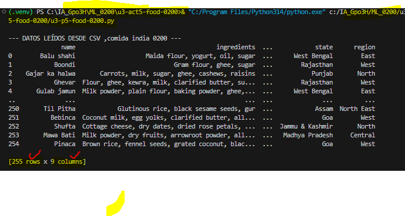
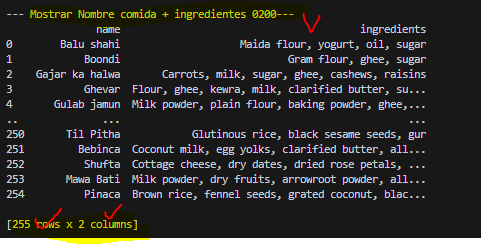
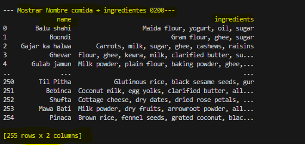
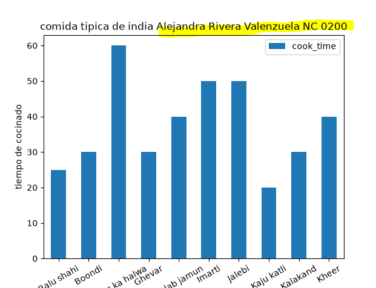
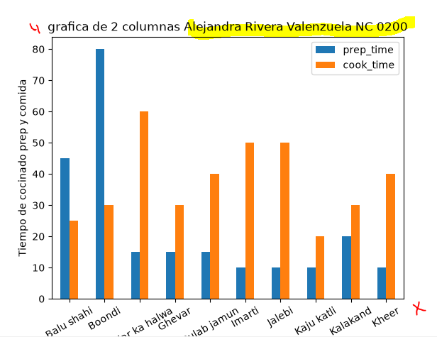
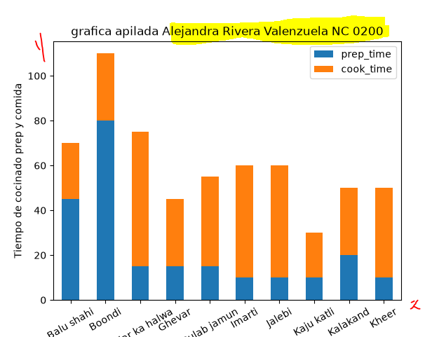

# Analisis exploratorio de datos
# Comida del pais India
# Alejandra Rivera Valenzuela NC = 0200

# +-+-+ importando datos del archivo csv comida de india+-+-+

# +-+-+ Mostrar Nombre comida + ingredientes

# tiempo de cocinado mostrar 10 registros con head

# creacion de grafica de barras 0200

# grafica de varias columnas

# grafica apilada
